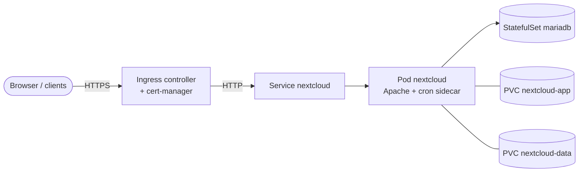

# Nextcloud on Kubernetes

Plain Kubernetes manifests for running [Nextcloud](https://nextcloud.com/) with MariaDB on a small cluster, written to be read and understood in one sitting. Kustomize (built into `kubectl`) is the only tool you need.

This is a learning resource and a starting point for homelabs and single-node clusters. For production or high availability, use the official [Nextcloud Helm chart](https://github.com/nextcloud/helm).

> **Coming from the 2018 blog post?** The original single-file layout (hostPath volumes, nginx proxy Pod, omgwtfssl) is preserved at the [`v1-legacy`](https://github.com/andremotz/nextcloud-kubernetes/tree/v1-legacy) tag. See [Migrating from v1-legacy](#migrating-from-v1-legacy) below. Background: [the original blog post](https://www.andremotz.com/nextcloud-docker-on-kubernetes-cluster-ssl-certificates/).

## What you get



- Nextcloud (Apache image) as a single-replica Deployment, with a cron sidecar for background jobs
- MariaDB as a StatefulSet with the settings Nextcloud recommends
- Application and user data on separate PersistentVolumeClaims
- Credentials in a Kubernetes Secret that is never committed
- Probes, resource requests, dropped capabilities, Pod Security `baseline`
- TLS through your ingress controller and cert-manager

## Tested versions

| Component | Version |
| --- | --- |
| Kubernetes | 1.37 (kind) |
| Nextcloud | 34.0.6 (`nextcloud:34.0.6-apache`) |
| MariaDB | 11.8.9 |
| Traefik (example overlay) | 3.7.19, Helm chart 42.4.2 |
| cert-manager (example overlay) | 1.21.3 |

Last verified 2026-11-23. Other conformant clusters should work; only the combination above is tested. Image versions are set in one place, [`base/kustomization.yaml`](base/kustomization.yaml).

## Quick start (local, about two minutes)

Needs a cluster with a default StorageClass, such as [kind](https://kind.sigs.k8s.io/), minikube or k3s.

```sh
git clone https://github.com/andremotz/nextcloud-kubernetes.git
cd nextcloud-kubernetes
kubectl apply --server-side -k overlays/local
kubectl -n nextcloud rollout status deployment/nextcloud --timeout=10m
kubectl -n nextcloud port-forward svc/nextcloud 8080:80
```

Open <http://localhost:8080> and log in as `admin` / `local-admin-password`.

The local overlay has fake, committed credentials and no TLS. Never expose it beyond your machine.

## Real install

### Prerequisites

- A Kubernetes cluster with a **default StorageClass**. Bare kubeadm clusters have none; [local-path-provisioner](https://github.com/rancher/local-path-provisioner) is the simplest option on a single node (k3s ships it).
- An **ingress controller**. k3s ships Traefik.
- **cert-manager** ([installation](https://cert-manager.io/docs/installation/helm/)).
- For a trusted certificate: a public DNS name pointing at the cluster and port 80 reachable from the internet.

### Steps

1. Credentials:

   ```sh
   cp overlays/example/secrets.env.example overlays/example/secrets.env
   ```

   Fill in every value in `secrets.env` (it is git-ignored), for example with `openssl rand -base64 24`.

2. Settings: edit [`overlays/example/settings.env`](overlays/example/settings.env). Set your hostname (`NEXTCLOUD_TRUSTED_DOMAINS` and `OVERWRITECLIURL`) and your cluster's pod network (`TRUSTED_PROXIES`).

3. Certificate: the example uses a self-signed certificate. For Let's Encrypt, put your e-mail address into [`issuer-letsencrypt.yaml`](overlays/example/issuer-letsencrypt.yaml) and change the `cert-manager.io/cluster-issuer` annotation in [`ingress.yaml`](overlays/example/ingress.yaml) to `letsencrypt`.

4. Ingress controller: apply the settings below for your controller.

5. Deploy:

   ```sh
   kubectl apply --server-side -k overlays/example
   kubectl -n nextcloud rollout status deployment/nextcloud --timeout=10m
   ```

The first start copies Nextcloud into the volume and installs it, which takes a few minutes.

### Ingress controller settings

Nextcloud needs a few things from whatever sits in front of it. They are controller-specific, so they are not in the base.

| Requirement | Why |
| --- | --- |
| Request body limit at least `PHP_UPLOAD_LIMIT` (4G), or none | Larger uploads fail otherwise |
| Read timeout of about an hour | Large uploads are aborted otherwise |
| HTTP redirected to HTTPS | |
| HSTS header | Nextcloud's security check asks for it |
| `/.well-known/caldav` and `/.well-known/carddav` redirected to `https://<host>/remote.php/dav/` | Calendar and contacts auto-discovery. Nextcloud's own redirect points to `http://` behind a proxy |

**Traefik** (tested, and the k3s default):

- Install or upgrade Traefik with [`examples/traefik-values.yaml`](examples/traefik-values.yaml). It sets a 3600 s read timeout and the HTTP→HTTPS redirect. With Traefik's default 60 s timeout, a 1.3 GB upload failed with 502. On k3s, put the same `ports` settings into a [`HelmChartConfig`](https://docs.k3s.io/helm) for the bundled Traefik.
- Uncomment the `components` block in [`overlays/example/kustomization.yaml`](overlays/example/kustomization.yaml). This adds HSTS and the `.well-known` redirects.

**Other controllers:** configure the requirements in the table above using your controller's documentation. Contributions of tested components are welcome.

## Configuration

| Where | What |
| --- | --- |
| `overlays/example/settings.env` | Hostname, HTTPS overwrite, trusted proxies, upload limit, time zone |
| `overlays/example/secrets.env` | Database and admin credentials (git-ignored) |
| `overlays/example/kustomization.yaml` | Size of the user-data volume, controller component |
| `overlays/example/ingress.yaml` | Certificate issuer, `ingressClassName` |
| `base/kustomization.yaml` | Image versions |
| `base/*/` | Everything else: probes, resources, security settings |

## Operating it

- **Upgrades:**
  - Back up first.
  - Change the Nextcloud tag in `base/kustomization.yaml` and apply. The container runs the upgrade on start.
  - Nextcloud can only be upgraded **one major version at a time**.
  - MariaDB upgrades its data files automatically (`MARIADB_AUTO_UPGRADE`), but cannot downgrade them.
- **Background jobs** run every five minutes in the `cron` sidecar. A fresh install switches Nextcloud to "Cron" mode automatically.
- **Backups:** dump the database and copy both Nextcloud volumes, with maintenance mode on. See [spec 004](docs/specs/004-operations.md).
- **Changing the database password** in `secrets.env` does not change it inside an existing database. See spec 004 before rotating it.
- **Deleting the `nextcloud` namespace deletes the volumes and all data** with the usual `Delete` reclaim policy.
- **Secrets** are only base64-encoded in etcd unless your cluster [encrypts them at rest](https://kubernetes.io/docs/tasks/administer-cluster/encrypt-data/).
- **Uninstall:** `kubectl delete -k overlays/example`. This also removes the cluster-wide issuers; delete the namespace to remove the volumes.

### Before you expose it to the internet

- [ ] Real certificate (Let's Encrypt issuer)
- [ ] Strong, unique values in `secrets.env`
- [ ] Two-factor authentication enabled for the admin account
- [ ] Ingress controller settings applied, and the admin overview (Administration settings → Overview) shows no warnings
- [ ] A backup that you have restored at least once

## Migrating from v1-legacy

The old manifests stored data in host folders (`db-pv`, `nc-pv`). In outline:

1. Enable maintenance mode and dump the database.
2. Delete the old Deployments, Services and Pods. The host folders stay.
3. Apply the new overlay with the **same** database credentials and a Nextcloud tag of the **same major version** you were running.
4. Scale Nextcloud to 0. Copy `nc-pv` into the `nextcloud-app` volume, with its `data/` folder going into `nextcloud-data`. Import the dump into `mariadb-0`.
5. Scale to 1, disable maintenance mode, verify, and only then remove the host folders.

This procedure has not yet been tested end to end. Details are tracked in [spec 004](docs/specs/004-operations.md).

## Development

```sh
make lint       # yamllint, markdownlint
make validate   # render every overlay; kubeconform and kube-linter
make test       # lint, validate, create a kind cluster, deploy overlays/local, smoke test
make clean      # delete the kind cluster
```

The smoke test ([`hack/smoke-test.sh`](hack/smoke-test.sh)) checks:

- install status
- WebDAV login
- an upload and download
- cron mode
- that data survives deleting the Pod
- `occ check`

Design decisions, specs and the backlog are in [`docs/`](docs/README.md). Changes are listed in [`CHANGELOG.md`](CHANGELOG.md).

## License

GPL-3.0, see [LICENSE](LICENSE).
